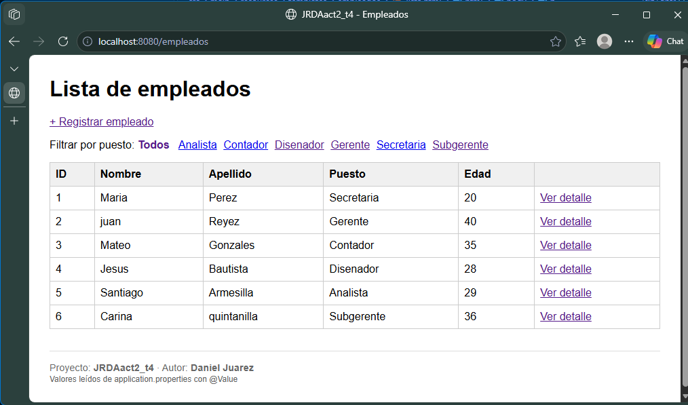
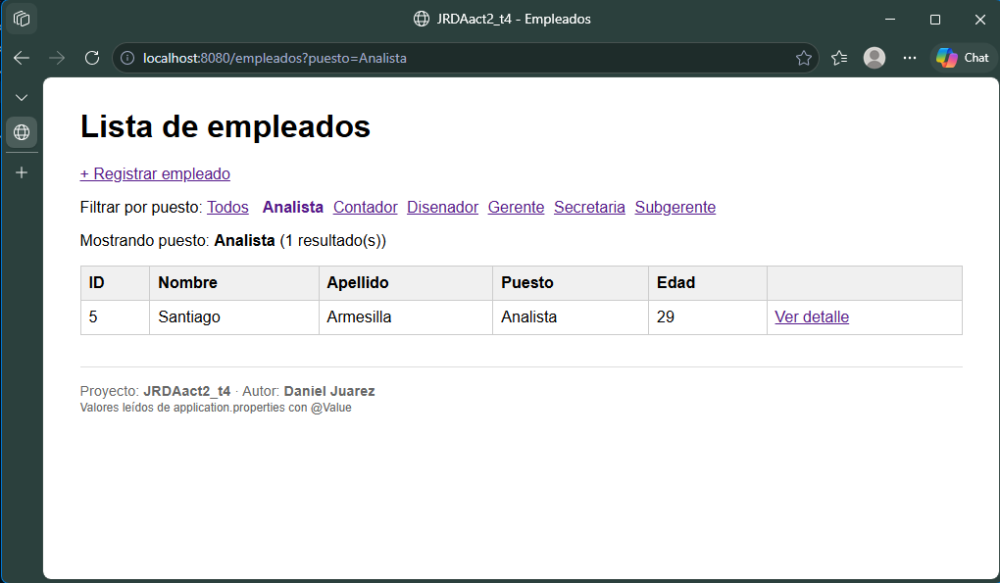
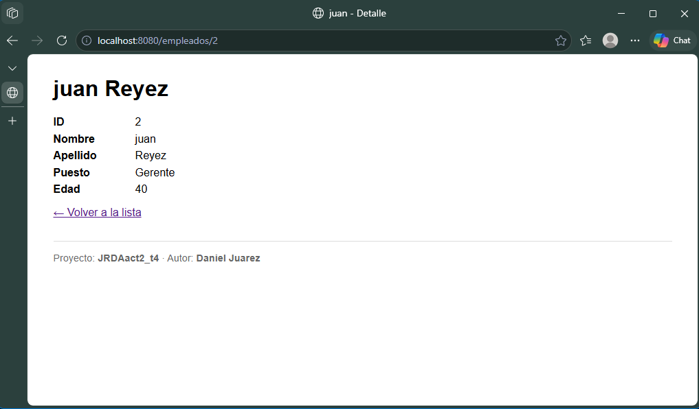
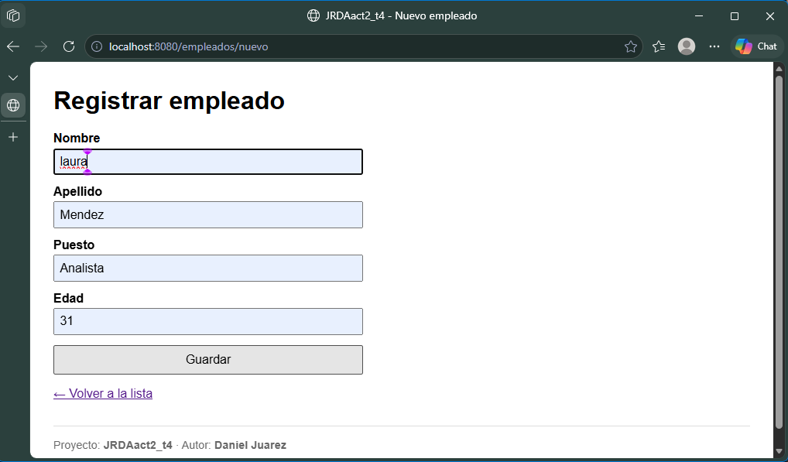
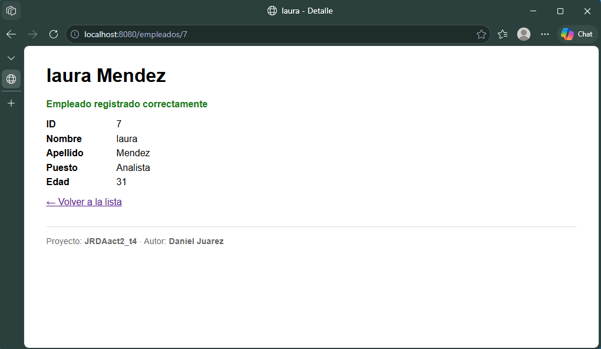
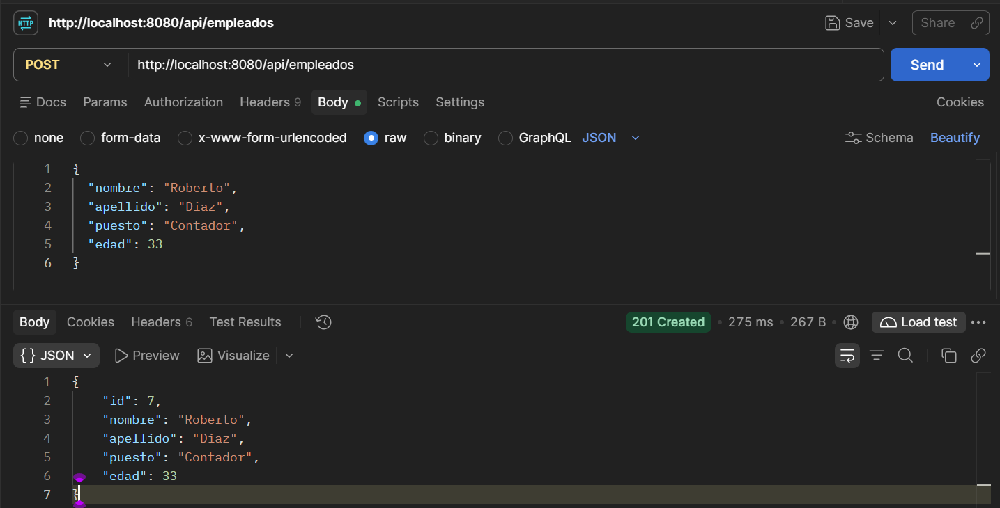
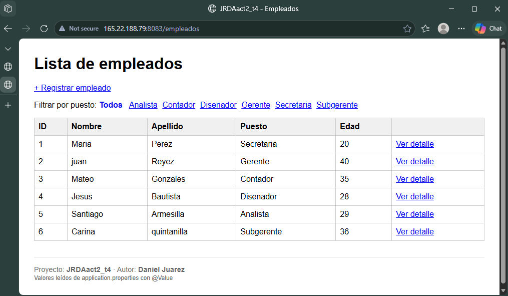
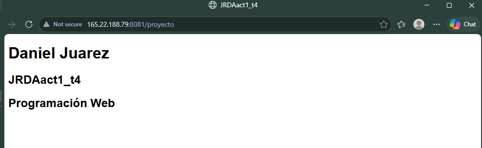

# JRDAact2_t4: MVC con Thymeleaf, DTOs y parámetros en Spring Boot

Actividad 2 del Tema 4 de Programación Web. Proyecto duplicado de la Actividad 1 ([JRDAact1_t4](https://github.com/DaniielA5/JRDAact1_t4)) y extendido con el patrón MVC: vistas Thymeleaf, clases DTO, `@RequestParam`, `@PathVariable`, `@ModelAttribute`, `@Value` y un endpoint POST REST probado en Postman.

**Autor:** Daniel Juárez

**En línea:** http://165.22.188.79:8083/empleados

## Tecnologías
- Java 21
- Spring Boot 4.1.2 (Spring Web MVC)
- Thymeleaf
- Maven (wrapper incluido)

## Arquitectura (MVC)

```
controllers/
├── EmpleadoController.java       @Controller      → regresa vistas Thymeleaf
└── EmpleadoRestController.java   @RestController  → regresa JSON
models/
├── Empleados.java                entidad (incluye teléfono y dirección)
└── dto/EmpleadoDTO.java          DTO (solo id, nombre, apellido, puesto, edad)
services/
└── EmpleadoService.java          datos en memoria + conversión entidad → DTO
templates/empleados/
├── lista.html                    th:each + filtro + @Value
├── detalle.html                  detalle por id
└── formulario.html               th:object + th:field
```

| Capa | Archivos | Responsabilidad |
|---|---|---|
| **Modelo** | `EmpleadoService`, `Empleados`, `EmpleadoDTO` | Datos y reglas (filtrar, buscar, crear, convertir a DTO) |
| **Vista** | `templates/empleados/*.html` | Mostrar lo que el controlador pone en el `Model` |
| **Controlador** | `EmpleadoController`, `EmpleadoRestController` | Recibir la petición, llamar al servicio y elegir vista o JSON |

Ambos controladores comparten el mismo `EmpleadoService`, así que un empleado creado desde el formulario o desde Postman aparece en la lista.

## Endpoints

### Vistas (`EmpleadoController`)

| Método | Ruta | Concepto | Descripción |
|---|---|---|---|
| GET | `/empleados` | `Model` + `th:each` + `@Value` | Lista de empleados |
| GET | `/empleados?puesto=Analista` | `@RequestParam` | Lista filtrada por puesto |
| GET | `/empleados/{id}` | `@PathVariable` | Detalle de un empleado |
| GET | `/empleados/nuevo` | `th:object` | Formulario de registro |
| POST | `/empleados/nuevo` | `@ModelAttribute` | Recibe el formulario y redirige al detalle |

### API REST (`EmpleadoRestController`)

| Método | Ruta | Concepto | Respuesta |
|---|---|---|---|
| GET | `/api/empleados` | `@RequestParam` opcional | `200` + lista JSON |
| GET | `/api/empleados/{id}` | `@PathVariable` | `200` o `404` |
| POST | `/api/empleados` | `@RequestBody EmpleadoDTO` | `201 Created` o `400` |

### Propiedades personalizadas (`@Value`)

En `application.properties`:
```properties
app.autor = Daniel Juarez
app.proyecto = JRDAact2_t4
```
Se inyectan en `EmpleadoController` con `@Value("${app.autor}")` y `@Value("${app.proyecto}")`, y se muestran en el pie de las vistas.

## Capturas

### Lista con `th:each` y `@Value`
`GET /empleados`: la tabla se genera con `th:each`; el pie muestra los valores leídos con `@Value`.



### `@RequestParam`: filtro por puesto
`GET /empleados?puesto=Analista`



### `@PathVariable`: detalle por id
`GET /empleados/2`



### Formulario con `@ModelAttribute`
`GET /empleados/nuevo`, con el formulario lleno antes de enviarse:



Después de enviarlo, `POST /empleados/nuevo` recibe un `EmpleadoDTO` con `@ModelAttribute`, lo guarda y redirige al detalle:



### POST REST probado en Postman
`POST /api/empleados` con body JSON; responde `201 Created` con el empleado creado:

```json
{
  "nombre": "Roberto",
  "apellido": "Diaz",
  "puesto": "Contador",
  "edad": 33
}
```



### Despliegue en el VPS
Actividad 2 corriendo en el puerto **8083**:



Actividad 1 (8081) y Actividad 2 (8083) corriendo al mismo tiempo:



## Ejecutar en local

```bash
.\mvnw.cmd spring-boot:run
```

Disponible en `http://localhost:8080/empleados`.

## Generar el JAR

```bash
.\mvnw.cmd clean package
```

El archivo queda en `target/jrdaact2-0.0.1-SNAPSHOT.jar`.

## Despliegue en el VPS

```bash
scp target/jrdaact2-0.0.1-SNAPSHOT.jar USUARIO@IP_DEL_VPS:~/jrda_act2/jrda_act2.jar
nohup java -Xmx192m -jar jrda_act2.jar --server.port=8083 > app.log 2>&1 &
```

El VPS es compartido, por eso cada app tiene su puerto:

| Puerto | Proyecto |
|---|---|
| 8081 | Actividad 1 (JRDAact1_t4), sin cambios |
| 8082 | Compañero de vps  |
| 8083 | **Actividad 2 (este proyecto)** |

`-Xmx192m` limita el heap de la JVM, y se agregó un swap de 2 GB para que las apps quepan en el VPS de 1 GB de RAM.

## Ejemplos del curso (videos 8–17)
También se conservan los ejercicios hechos siguiendo la playlist:

| Ruta | Video / concepto |
|---|---|
| `/detalles_info` | Objeto `Model`, `@ModelAttribute` en método, `th:each` |
| `/api/ejemploRest` | DTO (`ClaseDTO`) |
| `/api/parametros/detalle?informacion=...` | `@RequestParam` |
| `/api/variable/pagina1/{mensaje}` | `@PathVariable` |
| `/api/variable/solicitud` (POST) | `@RequestBody` |
| `/api/variable/valores` | `@Value` |
